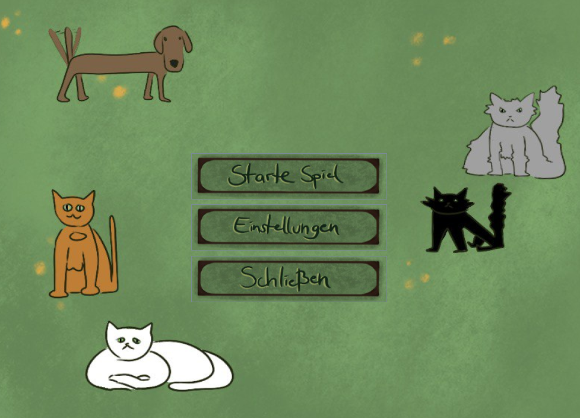
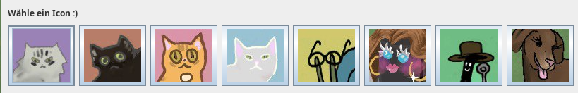
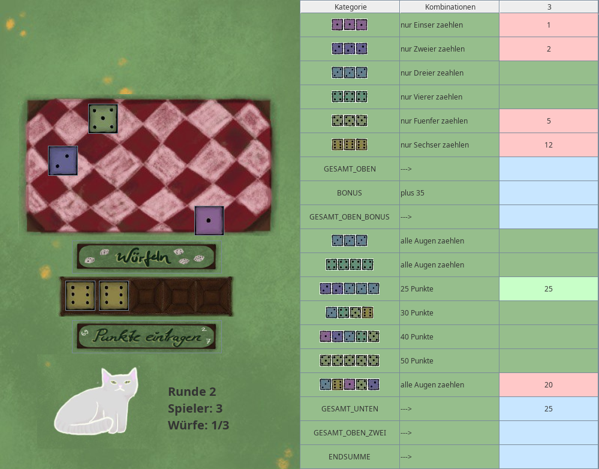

# Kniffel (Yahtzee)

A Java implementation of the dice game Kniffel (Yahtzee), built as a university project.
The game features a graphical user interface and implements the classic scoring rules.





## Features
- Full Kniffel/Yahtzee scoring logic (upper and lower section)
- Graphical user interface for rolling dice and tracking scores
- Turn-based gameplay for multiple players

## Tech Stack
- **Language:** Java
- **GUI:** Java Swing
- **Build/IDE:** Eclipse

## Setup

### Prerequisites
- Java JDK (version 8 or newer)
- Eclipse IDE (or any Java IDE that can import Eclipse projects)

### Run in Eclipse
1. Clone the repository:
   ```bash
   git clone https://github.com/xMenetekel/Kniffel.git
   
2. In Eclipse: File → Import → General → Existing Projects into Workspace.

3. Select the cloned Kniffel folder and click Finish.

4. Open the main class in src/ and run it via Run → Run As → Java Application.

## Authors and acknowledgments
#### Authors
Corinna Huber\
Anne Göbel\
Anthony Lachmann

#### Acknowledgements\
Bubu, Bebi, Crystal, Kiki, Fay, Lotte, Marie


